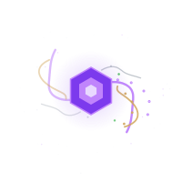

<div align="center">



# Gentian Line

**Memory harness and project management systems for humans and LLMs.**


</div>

---
Why the name? 

House of Suns by Alastair Reynolds concerns the Gentian Line, also known as the House of Flowers, composed of Abigail Gentian and her 999 clones (or "shatterlings").  The clones and Abigail travel the Milky Way Galaxy, helping young civilizations, collecting knowledge, and experiencing what the universe has to offer. Members of the Gentian Line are named after flowering plants.

That is roughly the situation our agents are in, and it is not a problem we intend to
"solve" so much as *instrument*. Every clone gets its own ledger; every ledger stays
coherent; nothing silently forgets because something else carefully remembered.  This way our goals can survive the
test of time.
What happens when we move from a Mixture of Experts to a evolving network of them?

## What we are doing

Two repos, one goal: **memory and executing** on one side, **planning and tracking** on the other.

### [`clm-mem`](https://github.com/GentianLine/clm-mem) — memory that the model does to itself

A **zero-training memory harness** for open chat models. The same model that reads and
writes text also classifies its own context as *long-term*, *short-term* or *transient*
while decoding, and a small deterministic engine then enforces the token budget in three
phases (drop transient → short-term FIFO rounds → archive long-term with a recall stub).

This is our reading of **Context Language Models** (Shao et al., arXiv:2609.37725): treat
context as an editable artifact mirrored to disk, and delegate context management to the
model via prompting rather than to a router bolted on afterwards. The paper's method pays
for that freedom by invalidating the KV cache every request; we pay for it only when the
window actually overflows, so the churn stays low — and any improvement made to KV-cache
management helps us too.

The important consequence: **the model decides what matters as it is creating context, not
after context has grown.** The human stays in charge of the ask; the hardware keeps reliable
expectations about its load; no exotic new cache strategy required but any improvements will help.

### [`tokamak`](https://github.com/GentianLine/tokamak) — story points at plasma pressure

A Django + django-unicorn story-point board with one service layer behind everything, custom
signals on every project and ticket state change, an append-only `EventLog`, Fibonacci-only
estimates, a real blockers graph, and sprint-line/cutoff forecasting derived from accepted
velocity.

It is named after the fusion device because that is what a good team feels like: a configuration
where energy is held in place by opposing forces precisely enough that something rare happens.

Tokamak is our **human-first approach to agile**: it leverages AI aggressively — signals,
automation receivers, an optional memory bridge — while refusing to turn people into machines.
Nobody's judgement is replaced; their bookkeeping is. Tickets do not mutate workflow state
silently, automation cannot invent estimates out of nowhere, and every machine action is
auditable in the event log so a human can disagree with it later.

### The bridge

Every Tokamak signal and `EventLog` row can optionally mirror into per-project sessions of
`clm-mem`. Tickets that enter work open monitored chat sessions; ending them distils a summary
plus durable facts back onto the ticket, with archive handoff so a reopened attempt inherits
what the previous one learned. Off by default. Fully offline-testable.

## What we are researching

We are measuring **the effects of different memory strategies across open models** — eviction
policy, tag granularity, keep-percentages, classify-as-you-decode versus post-turn routing,
archive-plus-recall versus plain truncation — across Qwen-family and other OpenAI-compatible
backends (vLLM, Ollama, llama.cpp, LM Studio, Unsloth Studio, Featherless).

Preliminary orientation from the literature: finer-grained memory organisation is *not*
universally beneficial. Designs that produce strong forward transfer can simultaneously induce
severe forgetting. External memory does not resolve continual learning; it **reshapes** it into
a problem of memory representation and retrieval design. We intend to be very serious about
that sentence, in public, with reproducible environments.

## Conventions

- **Memory is explicit.** In `clm-mem serve`, memory is never a header side-effect of
  `/v1/chat/completions` — that route stays pure passthrough. You *open* a branch, then you
  *turn* on it. `410` exists to tell you so.
- **Nothing is silently destroyed.** Long-term memory is offloaded to an archive and left as a
  retrievable stub; the failure mode of "can offload but cannot evict" is not welcome here.
- **Humans are not demoted.** Automation may propose, tag, flag, mirror and distil. It may not
  impersonate a person's decision. `EventLog` is the receipt.
- **Reproducibility over vibes.** Pinned lockfiles, `black --check`, CI gates, tests as the
  definition of behaviour.

## Repos

| Repo | Stack | What it does |
|---|---|---|
| [`clm-mem`](https://github.com/GentianLine/clm-mem) | Python ≥3.10 | Zero-training long/short-term context-memory harness: token-budgeted window, three-phase eviction, archive + recall, web studio, MCP toolbox, agent mode with sandboxing. |
| [`tokamak`](https://github.com/GentianLine/tokamak) | Django + django-unicorn + DRF | Story-point board, signal-driven automation, velocity/cutoff forecasting, optional `clm-mem` memory bridge and ticket sessions. |

## Get started

```bash
# Memory harness (works with no GPU using bundled mock backends)
git clone https://github.com/GentianLine/clm-mem && cd clm-mem
python -m venv .venv && source .venv/bin/activate
pip install -e ".[dev]"
clm-mem serve --use-mock --port 8080 --served-model mock-model \
    --max-context-tokens 600 --workdir /tmp/clm-serve

# Project board
git clone https://github.com/GentianLine/tokamak && cd tokamak
pip install -r requirements.txt
python manage.py migrate && python manage.py seed_demo && python manage.py runserver
```

## Contributing

Issues and pull requests on both repos are welcome; read
`CONTRIBUTING.md` in the repo you are touching, keep tests as the specification, and format with
the pinned `black`. Joining notes for humans: bring curiosity, distrust of magic, and a
willingness to name a mechanism after the cognitive-science literature that inspired it.

---

<div align="center">


<br/>

> *We do not make the machine more human. We make the record trustworthy enough that humans can afford to be.*

</div>
